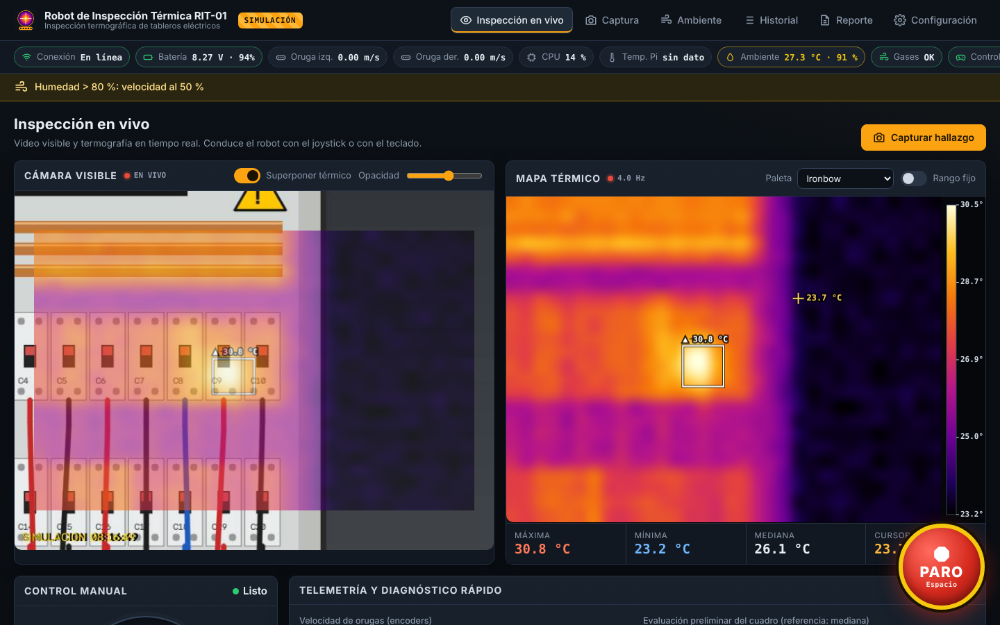
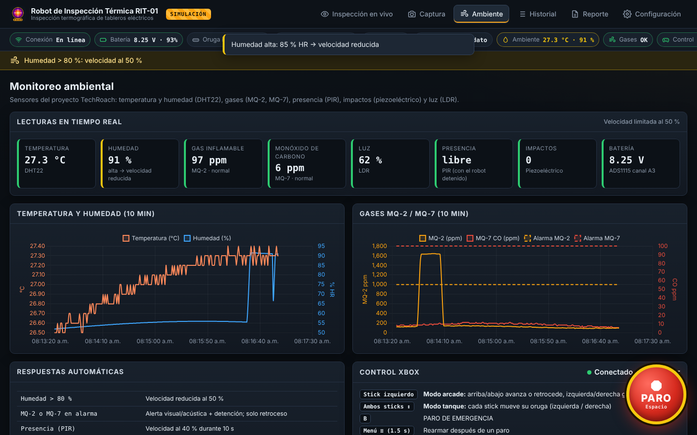
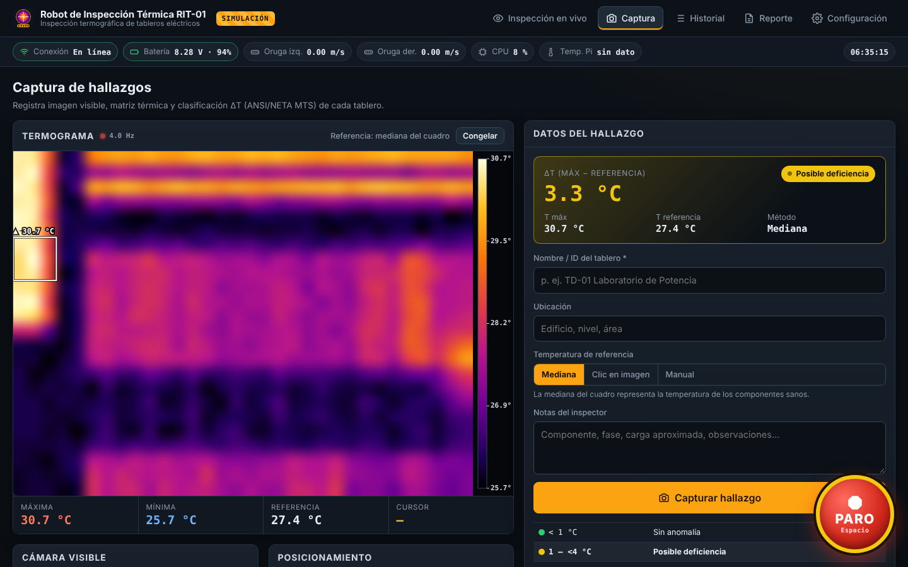
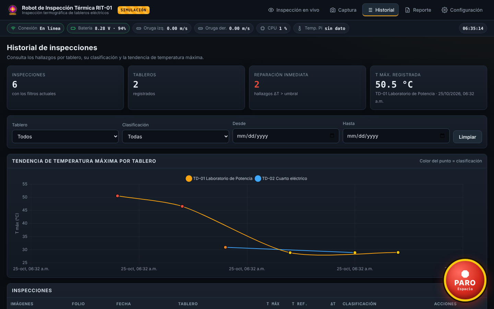
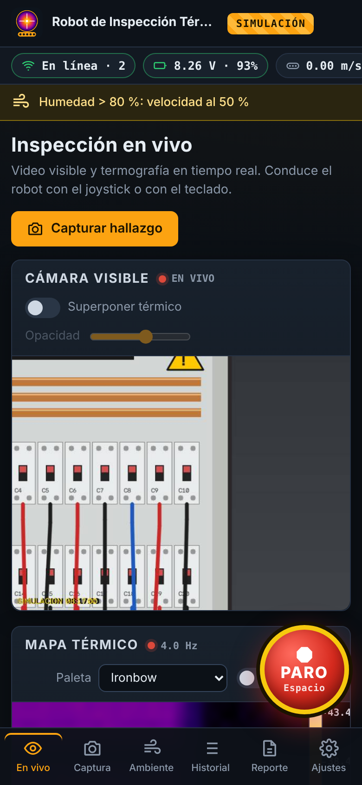
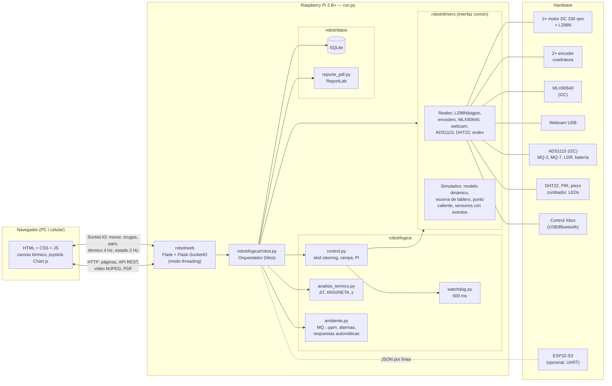

# Robot móvil de inspección térmica de tableros eléctricos

Proyecto académico de **Ingeniería Mecatrónica**. Es un robot con tracción por orugas, controlado por una **Raspberry Pi 3 Model B+**, que recorre una instalación y hace inspecciones termográficas de tableros eléctricos. El software muestra en el navegador (computadora o celular) el video visible y el mapa térmico en vivo, y permite conducir el robot. Cada hallazgo se clasifica con el criterio **ΔT de ANSI/NETA MTS** y se genera un **reporte PDF** con referencia a **NOM-029-STPS** y **NFPA 70B**.

Además reutiliza los **sensores ambientales del proyecto anterior, TechRoach** (DHT22, MQ-2, MQ-7, PIR, piezoeléctrico y LDR), ahora conectados a la Raspberry Pi y con las mismas respuestas automáticas. Usa una **webcam USB** en lugar de la ESP32-CAM y se puede manejar con un **control Xbox** (temporal; a futuro se diseñará un control dedicado).

> Todo el sistema funciona también **sin hardware** (modo simulación) en cualquier laptop, con la misma interfaz.



| Monitoreo ambiental (TechRoach) | Captura de hallazgos |
|---|---|
|  |  |

| Historial y tendencia | Celular |
|---|---|
|  |  |

---

## Contenido

1. [Características](#características)
2. [Arquitectura](#arquitectura)
3. [Estructura del proyecto](#estructura-del-proyecto)
4. [Hardware y tabla de pines](#hardware-y-tabla-de-pines)
5. [Instalación en la Raspberry Pi](#instalación-en-la-raspberry-pi)
6. [Modo simulación (laptop)](#modo-simulación-laptop)
7. [Uso de la interfaz](#uso-de-la-interfaz)
8. [Seguridad](#seguridad)
9. [Análisis térmico y clasificación ΔT](#análisis-térmico-y-clasificación-δt)
10. [Sensores ambientales (TechRoach)](#sensores-ambientales-techroach)
11. [Control Xbox](#control-xbox)
12. [Calibración del diámetro de la rueda](#calibración-del-diámetro-de-la-rueda)
13. [Pruebas](#pruebas)
14. [ESP32-S3 opcional](#esp32-s3-opcional)
15. [API](#api)
16. [Rendimiento en la Raspberry Pi 3 B+](#rendimiento-en-la-raspberry-pi-3-b)
17. [Solución de problemas](#solución-de-problemas)
18. [Normas de referencia](#normas-de-referencia)

---

## Características

| Área | Funciones |
|---|---|
| **Inspección en vivo** | Video visible MJPEG (640×480, 12 fps) y mapa térmico (32×24, 4 Hz) lado a lado; superposición del térmico sobre el visible con transparencia ajustable; paletas ironbow, arcoíris, grises y lava con escala de temperatura; temperatura máxima, mínima, mediana y bajo el cursor; recuadro sobre el punto más caliente. |
| **Conducción** | Joystick táctil, teclado (WASD/flechas) y **control Xbox** (modo arcade o tanque, conectado al navegador o directo a la Pi). Limitador de velocidad, rampa de aceleración y control PI de velocidad con encoders. |
| **Sensores TechRoach** | DHT22, MQ-2, MQ-7, PIR, piezoeléctrico y LDR con sus respuestas automáticas: humedad alta reduce la velocidad, gas detiene el robot (solo permite retroceder), presencia reduce la velocidad, un impacto detiene el robot y la poca luz enciende la iluminación. Página **Ambiente** con gráficas en vivo y registro de eventos. |
| **Barra de estado** | Conexión, batería (ADS1115, o "sin dato"), velocidad de cada oruga medida con encoders, CPU y temperatura de la Pi, ambiente (T/HR), gases y control conectado. |
| **Captura** | Guarda imagen visible, matriz térmica, fecha, ID del tablero, ubicación y notas. ΔT contra la mediana del cuadro, contra un punto elegido con un clic o contra un valor manual. Clasificación automática ANSI/NETA. |
| **Historial** | Tabla con filtros (tablero, clasificación, fechas), miniaturas, detalle y gráfica de tendencia de temperatura máxima (Chart.js). |
| **Reporte PDF** | Encabezado con logo configurable, imágenes, temperaturas, ΔT, clasificación, recomendación, criterio de evaluación, marco normativo y espacio para firmas. |
| **Configuración** | Velocidad máxima, aceleración, diámetro de la rueda (variable), umbrales ΔT, emisividad, paleta, alineación térmico/visible, ESP32 y diagnóstico de componentes. |
| **Seguridad** | Watchdog de 500 ms, paro por desconexión, botón de PARO DE EMERGENCIA y tecla Espacio, límite de 0.3 m/s (ISO 3691-4), y motores en cero al arrancar y al cerrar el programa. |

---

## Arquitectura



**Capas:**

1. **Drivers** (`robot/drivers`): cada componente tiene una clase abstracta (`base.py`) con una versión real y una simulada. `fabrica.py` elige cuál usar según `ROBOT_SIM`. Si un componente real falla al iniciar, se reemplaza por un driver "nulo" y la falla aparece en *Configuración → Diagnóstico*.
2. **Lógica** (`robot/logica`): watchdog, control de tracción, análisis térmico, paletas, generación de imágenes y el orquestador `Robot`. No depende de Flask.
3. **Datos** (`robot/datos`): SQLite y generación del PDF.
4. **Servidor web** (`robot/web/app.py`, `socket_eventos.py`): REST, MJPEG y Socket.IO.
5. **Frontend** (`robot/web/templates`, `robot/web/static`): HTML, CSS y JavaScript sin frameworks ni compilación.

**Hilos en ejecución:**

| Hilo | Frecuencia | Función |
|---|---|---|
| `control-traccion` | 50 Hz | Watchdog, rampa, PI y PWM de los motores |
| `camara-termica` | 4 Hz | Lectura MLX90640, corrección de emisividad y estadísticas |
| `camara-visible` | 12 fps (2 fps sin espectadores) | Captura; JPEG compartido entre clientes |
| `sensores` | 2 Hz | Sensores de TechRoach, alarmas, respuestas automáticas, zumbador/LEDs |
| `control-xbox` | 20 Hz | Control Xbox conectado a la Pi (si existe) |
| `estado` | 2 Hz | CPU, temperatura, batería y velocidades |

---

## Estructura del proyecto

```
inspeccion-tableros/
├── config.yaml                  Pines y parámetros (comentado)
├── run.py                       Punto de entrada
├── requirements.txt             Dependencias para la Pi
├── requirements-sim.txt         Dependencias para la laptop y las pruebas
├── robot/
│   ├── config.py                Carga, validación y persistencia de la configuración
│   ├── drivers/
│   │   ├── base.py              Interfaces comunes (y drivers nulos)
│   │   ├── motores_l298n.py     PWM por hardware con pigpio
│   │   ├── encoders_pigpio.py   Decodificación de cuadratura ×4 / ×1
│   │   ├── mlx90640.py          Cámara térmica por I2C
│   │   ├── camara_visible.py    Webcam USB (o Pi Camera), detección automática
│   │   ├── sensores_rpi.py      ADS1115, DHT22, PIR, piezo y salidas de alarma
│   │   ├── control_xbox.py      Control Xbox conectado a la Pi (evdev)
│   │   ├── esp32_uart.py        Protocolo JSON por línea (opcional)
│   │   ├── sistema.py           CPU, temperatura y RAM
│   │   ├── simulados.py         Motores, encoders, cámaras y batería simulados
│   │   └── fabrica.py           Selección real/simulado
│   ├── logica/
│   │   ├── watchdog.py          Paro si no llegan comandos en 500 ms
│   │   ├── control.py           Skid steering, rampa, límite de velocidad, PI
│   │   ├── analisis_termico.py  Estadísticas, referencia, ΔT, ANSI/NETA, emisividad
│   │   ├── ambiente.py          Sensores TechRoach: ppm, filtros, alarmas, respuestas
│   │   ├── gamepad.py           Mapeo del control Xbox (arcade / tanque)
│   │   ├── paletas.py           Paletas de color compartidas con el navegador
│   │   ├── imagen_termica.py    Termogramas, superposición y miniaturas
│   │   ├── bateria.py           Estado de carga de la LiPo
│   │   └── robot.py             Orquestador
│   ├── datos/
│   │   ├── db.py                SQLite (tableros e inspecciones)
│   │   └── reporte_pdf.py       Reporte PDF con ReportLab
│   └── web/
│       ├── app.py               Flask: páginas, API, MJPEG
│       ├── socket_eventos.py    Socket.IO: movimiento, paro, telemetría
│       ├── templates/           base, en_vivo, captura, ambiente, historial, reporte, configuracion
│       └── static/              css/panel.css, js/*.js, img/logo.png, vendor/ (Socket.IO, Chart.js)
├── scripts/
│   ├── instalar_pi.sh           Instalador para la Pi (servicio systemd, robot.local)
│   ├── robot-inspeccion.service Plantilla del servicio
│   ├── generar_logo.py          Regenera el logo por defecto
│   └── pruebas/                 Pruebas de cada componente por separado
│       ├── probar_motores.py
│       ├── probar_encoders.py
│       ├── probar_mlx90640.py
│       ├── probar_camara.py
│       ├── probar_sensores.py
│       ├── probar_control_xbox.py
│       ├── calibrar_gases.py
│       └── calibrar_diametro.py
├── firmware/esp32_ejemplo/      Sketch de ejemplo para el ESP32-S3 (opcional)
├── tests/                       Pruebas con pytest
└── data/                        (se crea al ejecutar) BD, capturas, PDFs, config del usuario
```

---

## Hardware y tabla de pines

### Componentes

| Componente | Modelo | Interfaz |
|---|---|---|
| Computadora | Raspberry Pi 3 Model B+ (1 GB), Raspberry Pi OS Lite 64 bits | — |
| Tracción | 2 motores DC 330 rpm con encoder, orugas (skid steering) | PWM + GPIO |
| Driver de motores | L298N (puente H doble) | PWM + GPIO |
| Cámara térmica | Melexis MLX90640 (32×24, FOV 55°×35°) | I2C (0x33) |
| Cámara visible | Webcam USB (reemplaza a la ESP32-CAM de TechRoach) | USB |
| ADC | ADS1115 (16 bits, 4 canales) | I2C (0x48) |
| Temperatura y humedad | DHT22 | GPIO (1 hilo) |
| Gases inflamables | MQ-2 | ADS1115 A0 |
| Monóxido de carbono | MQ-7 | ADS1115 A1 |
| Luz | LDR + resistencia de 10 kΩ | ADS1115 A2 |
| Presencia | PIR HC-SR501 | GPIO |
| Impactos | Módulo piezoeléctrico / vibración | GPIO |
| Alertas | Zumbador activo + LED rojo | GPIO |
| Iluminación | Tira o LED de potencia con MOSFET | GPIO |
| Control manual | Control Xbox One / Series | USB o Bluetooth |
| Alimentación | Batería LiPo 2S 7.4 V (leída con ADS1115 A3) | — |
| Opcional | ESP32-S3 | UART |

### Tabla de pines (numeración BCM)

| Señal | GPIO (BCM) | Pin físico | Conecta a | Notas |
|---|---|---|---|---|
| ENA (PWM motor izq.) | **GPIO18** | 12 | L298N ENA | PWM por hardware, canal PWM0 (quitar el puente de ENA) |
| IN1 | **GPIO23** | 16 | L298N IN1 | Dirección motor izquierdo |
| IN2 | **GPIO24** | 18 | L298N IN2 | Dirección motor izquierdo |
| ENB (PWM motor der.) | **GPIO13** | 33 | L298N ENB | PWM por hardware, canal PWM1 (quitar el puente de ENB) |
| IN3 | **GPIO27** | 13 | L298N IN3 | Dirección motor derecho |
| IN4 | **GPIO22** | 15 | L298N IN4 | Dirección motor derecho |
| Encoder izq. A | **GPIO17** | 11 | Encoder izq. C1 | Pull-up interno |
| Encoder izq. B | **GPIO16** | 36 | Encoder izq. C2 | Pull-up interno |
| Encoder der. A | **GPIO5** | 29 | Encoder der. C1 | Pull-up interno |
| Encoder der. B | **GPIO6** | 31 | Encoder der. C2 | Pull-up interno |
| I2C SDA | **GPIO2** | 3 | MLX90640 SDA y ADS1115 SDA | I2C-1 a 400 kHz (bus compartido) |
| I2C SCL | **GPIO3** | 5 | MLX90640 SCL y ADS1115 SCL | |
| DHT22 datos | **GPIO4** | 7 | DHT22 pin 2 | Pull-up de 10 kΩ a 3.3 V |
| PIR | **GPIO25** | 22 | HC-SR501 OUT | Salida de 3.3 V |
| Piezoeléctrico | **GPIO20** | 38 | Módulo DO | Si el módulo es de 5 V, usar divisor |
| Zumbador | **GPIO21** | 40 | Transistor NPN → zumbador | Alerta acústica |
| LED de alarma | **GPIO19** | 35 | LED rojo + 330 Ω | Alerta visual |
| Iluminación | **GPIO26** | 37 | Compuerta del MOSFET | Se enciende con poca luz (LDR) |
| MQ-2 DO (respaldo) | GPIO7 | 26 | MQ-2 DO | Solo sin ADS1115, con divisor a 3.3 V |
| MQ-7 DO (respaldo) | GPIO8 | 24 | MQ-7 DO | Solo sin ADS1115, con divisor a 3.3 V |
| UART TX | GPIO14 | 8 | ESP32 RX | Solo si se usa el ESP32 |
| UART RX | GPIO15 | 10 | ESP32 TX | Solo si se usa el ESP32 |
| 3.3 V | — | 1, 17 | MLX90640, ADS1115, DHT22, encoders | Los encoders deben alimentarse a 3.3 V |
| 5 V | — | 2, 4 | MQ-2, MQ-7 (calefactor), PIR | Los MQ consumen ~150 mA cada uno |
| GND | — | 6, 9, 14… | GND común | Unir GND de la Pi, el L298N y la batería |

### Alimentación recomendada

```
 LiPo 2S 7.4 V ──┬──► L298N  +12V (VS)  ──► motores (≈5.4 V efectivos por la caída del L298N)
                 │
                 └──► Convertidor reductor (buck) 5 V / 3 A ──► Raspberry Pi (pines 2/4 o USB)

 GND batería ═══ GND L298N ═══ GND Raspberry Pi (tierra común obligatoria)
```

### Conexión de los sensores analógicos (ADS1115)

La Raspberry Pi **no tiene entradas analógicas** (el ESP32 de TechRoach sí), por eso los sensores analógicos se leen con un ADS1115 alimentado a **3.3 V**:

```
 MQ-2 AO ──[10 kΩ]──┬── A0         MQ-7 AO ──[10 kΩ]──┬── A1
                  [20 kΩ]                          [20 kΩ]
                    │                                │
                   GND                              GND        (0-5 V → 0-3.3 V; config: divisor_mq = 1.5)

 3.3 V ──[LDR]──┬── A2             LiPo + ──[10 kΩ]──┬── A3
             [10 kΩ]                              [4.7 kΩ]
                │                                    │
               GND                                  GND        (8.4 V → 2.7 V; config: divisor_bateria = 3.128)
```

> Si no hay ADS1115, el robot sigue funcionando: las alarmas de gas usan la salida digital **DO** de los módulos MQ (umbral fijado con su potenciómetro). En ese caso no hay ppm, luz ni batería.

> ⚠️ **No alimentes la Pi desde el regulador de 5 V del L298N**: no da suficiente corriente y el ruido de los motores reinicia la Pi. **Los encoders a 3.3 V**: los GPIO de la Pi no toleran 5 V.

> El valor `rpm_nominales: 330` corresponde al voltaje nominal del motor. Con 7.4 V y la caída del L298N la velocidad real es menor. El control en lazo cerrado con encoders compensa esta diferencia.

---

## Instalación en la Raspberry Pi

1. Graba **Raspberry Pi OS Lite (64 bits)** con Raspberry Pi Imager. En los ajustes avanzados configura Wi-Fi, usuario y SSH.
2. Copia el proyecto a la Pi y ejecuta el instalador:

   ```bash
   sudo apt install -y git
   git clone <url-del-repositorio> inspeccion-tableros
   cd inspeccion-tableros
   sudo bash scripts/instalar_pi.sh
   sudo reboot
   ```

   El instalador hace lo siguiente:
   - Instala OpenCV, NumPy y picamera2 desde apt (vienen precompilados para ARM).
   - Instala **pigpio**. Si la versión del sistema no lo trae, lo compila desde el código fuente.
   - Habilita **I2C a 400 kHz**, UART y cámara, y desactiva el audio analógico, que comparte periférico con el PWM por hardware.
   - Crea el entorno virtual `.venv` (con `--system-site-packages`) e instala `requirements.txt`.
   - Habilita `pigpiod` y crea el servicio **`robot-inspeccion`**, que arranca el robot al encender la Pi, con un límite de memoria de 300 MB.
   - Cambia el hostname a **`robot`** y habilita mDNS (avahi).

3. Después de reiniciar, abre en el navegador: **http://robot.local:5000**

Comandos útiles:

```bash
journalctl -u robot-inspeccion -f        # ver mensajes en vivo
sudo systemctl restart robot-inspeccion  # reiniciar
sudo systemctl stop robot-inspeccion     # detener (necesario para usar los scripts de prueba)
sudo i2cdetect -y 1                      # el MLX90640 debe aparecer en 0x33
```

---

## Modo simulación (laptop)

Con `ROBOT_SIM=1` todo funciona sin hardware: motores con dinámica de primer orden, encoders, cámara visible con la imagen sintética de un tablero, y mapa térmico con un punto caliente que se mueve y cambia de intensidad, de modo que pasa por todas las clasificaciones. Al avanzar, el robot se acerca al tablero (zoom), y al girar la vista se desplaza.

```bash
python3 -m venv .venv
source .venv/bin/activate            # Windows: .venv\Scripts\activate
pip install -r requirements-sim.txt

ROBOT_SIM=1 python run.py            # Windows (PowerShell): $env:ROBOT_SIM=1; python run.py
# o bien:  python run.py --sim
```

Abre **http://localhost:5000**. La interfaz es idéntica a la de la Pi; solo aparece la insignia "SIMULACIÓN".

---

## Uso de la interfaz

| Página | Descripción |
|---|---|
| **Inspección en vivo** (`/`) | Video y térmico lado a lado. *Superponer térmico* coloca el mapa sobre el video y el control deslizante ajusta la opacidad. Pasa el cursor (o el dedo) sobre la imagen para leer la temperatura de ese punto. También muestra el joystick, la telemetría de las orugas y una evaluación ΔT preliminar. |
| **Captura** (`/captura`) | Escribe el ID del tablero, elige la referencia (mediana, *clic en imagen* o valor manual), agrega notas y presiona **Capturar hallazgo**. *Congelar* detiene la imagen para elegir la referencia con calma; se guarda exactamente ese cuadro. |
| **Ambiente** (`/ambiente`) | Sensores de TechRoach en vivo, gráficas de 10 min, respuestas automáticas, calibración de los MQ, guía del control Xbox, registro de eventos y (en simulación) botones para provocar eventos. |
| **Historial** (`/historial`) | Filtros por tablero, clasificación y fechas. Gráfica de tendencia de temperatura máxima por tablero (con ΔT cuando se filtra un solo tablero). Detalle, PDF y eliminación. |
| **Reporte** (`/reporte`) | Elige una inspección, revisa la vista previa y genera o descarga el PDF. Aquí también se configuran el logo, la empresa, el título y el responsable. |
| **Configuración** (`/configuracion`) | Parámetros de movimiento, análisis térmico, alineación térmico/visible, ESP32, diagnóstico de componentes y tabla de pines. |

**Controles:** joystick táctil · **W A S D** o flechas · **control Xbox** · **Espacio** o **B** del control = PARO DE EMERGENCIA · botón rojo **PARO**, siempre visible.

---

## Seguridad

| Medida | Implementación |
|---|---|
| **Watchdog 500 ms** | El navegador manda un comando `mover` cada 100 ms mientras hay movimiento. Si el lazo de control (50 Hz) no recibe un comando en 500 ms, pone los motores en cero **sin rampa** (`robot/logica/watchdog.py`). |
| **Pérdida de conexión** | Si se desconecta el navegador que maneja el robot, hay paro inmediato (`socket_eventos.py`). La pestaña oculta o la ventana sin foco también liberan los controles. |
| **Paro de emergencia** | Botón rojo grande en todas las páginas y tecla Espacio. Queda **enclavado**: ignora comandos hasta que se presiona *Rearmar* con confirmación. Se envía por Socket.IO y también por HTTP como respaldo. |
| **Velocidad máxima** | Configurable; por defecto **0.3 m/s** (ISO 3691-4). La interfaz advierte si se configura un valor mayor. El ciclo de trabajo también se limita, aunque falle el encoder. |
| **Alarma de gas** | Detención inmediata. Mientras dure, solo se permite retroceder (configurable a bloqueo total). Se activan el zumbador y el LED rojo. |
| **Control Xbox** | B = paro de emergencia. La desconexión del control provoca paro inmediato. |
| **Rampa** | La aceleración y la desaceleración normales se limitan a `aceleracion_m_s2` (0.4 m/s² por defecto). |
| **Arranque y cierre** | Los motores se ponen en cero al crear los drivers, al crear el controlador, al recibir SIGTERM/SIGINT, en `atexit` y al detener el servicio. |
| **Fallas de componentes** | Si un componente no inicia, se reemplaza por un driver nulo (el motor nulo nunca se mueve) y la falla aparece en el diagnóstico. |

---

## Análisis térmico y clasificación ΔT

**ΔT = T(punto más caliente) − T(referencia)**

La referencia puede ser:
- La **mediana** del cuadro (por defecto), que representa los componentes sanos.
- Un **punto** elegido con un clic (promedio 3×3).
- Un **valor manual**.

| ΔT | Clasificación | Color | Acción |
|---|---|---|---|
| < 1 °C | Sin anomalía | 🟢 verde | Mantenimiento rutinario |
| 1 – 3 °C | Posible deficiencia | 🟡 amarillo | Investigar y dar seguimiento |
| 4 – 15 °C | Reparar en próxima oportunidad | 🟠 naranja | Reparar en paro programado |
| > 15 °C | Reparación inmediata | 🔴 rojo | Reparar de inmediato |

Los umbrales se configuran desde la interfaz. Con valores continuos se aplica: `ΔT ≥ 1` → posible, `ΔT ≥ 4` → reparar, `ΔT > 15` → inmediata.

**Emisividad:** la biblioteca del MLX90640 calcula las temperaturas con ε = 0.95. El sistema las recalcula para la emisividad configurada con el modelo de cuerpo gris (Stefan-Boltzmann):

```
ε₀·T₀⁴ + (1−ε₀)·Tr⁴ = ε·T⁴ + (1−ε)·Tr⁴   →   T = ⁴√[(ε₀·T₀⁴ + (1−ε₀)·Tr⁴ − (1−ε)·Tr⁴) / ε]
```

---

## Sensores ambientales (TechRoach)

Se reutilizan los sensores del proyecto anterior, ahora conectados a la Raspberry Pi. Se mantienen las mismas reglas de respuesta automática y se agregan protecciones contra falsas alarmas, que fueron el principal desafío técnico reportado en TechRoach.

| Sensor | Variable | Respuesta automática |
|---|---|---|
| **DHT22** | Temperatura y humedad | Humedad > 80 % → velocidad al 50 %. La temperatura se usa además como temperatura reflejada para la corrección de emisividad del MLX90640. |
| **MQ-2** | Gases inflamables (ppm estimadas) | Alarma → alerta visual/acústica y detención. Mientras dure, solo se permite **retroceder** para salir de la zona. |
| **MQ-7** | Monóxido de carbono (ppm estimadas) | Igual que el MQ-2. |
| **PIR** | Presencia de personas | Velocidad al 40 % durante 10 s. Solo se evalúa con el robot detenido, porque un PIR en movimiento da falsos positivos. |
| **Piezoeléctrico** | Impactos y caídas | Detención y registro del evento. |
| **LDR** | Luz | Enciende la iluminación propia del robot. |

**Medidas contra falsas alarmas de los MQ:**
- **Calentamiento** de 3 min sin alarmas (10 s en simulación).
- **Filtro de mediana** de 5 muestras.
- **Confirmación** con 3 lecturas seguidas sobre el umbral.
- **Histéresis** del 10 % para liberar la alarma.

**Conversión a ppm:** `Rs = RL·(Vc − Vout)/Vout`, luego `ppm = a·(Rs/R0)^b` con las curvas de la hoja de datos. **R0 se calibra en aire limpio**, desde *Ambiente → Calibrar MQ en aire limpio* o con `scripts/pruebas/calibrar_gases.py`. Las ppm son **estimaciones**: los MQ no son instrumentos certificados.

**Cambios respecto a TechRoach:**

| TechRoach (ESP32) | Este proyecto (Raspberry Pi) |
|---|---|
| Lecturas analógicas con el ADC del ESP32 | ADS1115 por I2C |
| MQTT + LabVIEW | Interfaz web propia (página **Ambiente**: gráficas, eventos, calibración) |
| ESP32-CAM | Webcam USB |
| PIR → maniobra evasiva | PIR → velocidad reducida. Un PIR no indica dirección, así que una maniobra evasiva automática sería insegura; queda como mejora futura con visión artificial. |

Cada captura de hallazgo guarda también la temperatura, la humedad y los gases del momento, y el reporte PDF los incluye. En **modo simulación**, la página Ambiente tiene botones para **provocar eventos** (gas, CO, humedad, presencia, impacto, oscuridad) y demostrar las respuestas automáticas.

---

## Control Xbox

Solución temporal; como mejora futura se diseñará y fabricará un control dedicado. Funciona de dos maneras, y se pueden usar ambas:

1. **Conectado a la computadora o celular** que muestra la interfaz (USB o Bluetooth). Lo lee el navegador (Gamepad API) y no requiere configuración: conéctalo y presiona cualquier botón.
2. **Conectado directo a la Raspberry Pi** por USB (driver `xpad`) o por Bluetooth. Lo lee el robot con `evdev`, sin necesidad de abrir la interfaz.

| Control | Acción |
|---|---|
| Stick izquierdo | **Modo arcade**: arriba/abajo avanza o retrocede, izquierda/derecha gira |
| Ambos sticks (vertical) | **Modo tanque**: cada stick mueve su oruga de forma independiente |
| **B** | **PARO DE EMERGENCIA** |
| Menú ≡ (mantener 1.5 s) | Rearmar después de un paro |
| Vista ⧉ | Cambiar el modo arcade ↔ tanque |
| LB / RB | Limitador de velocidad −25 % / +25 % |
| A | Captura rápida (usa el último tablero capturado) |

**Seguridad:**
- Con el stick fuera de la zona muerta se envían comandos a 10–20 Hz, que alimentan el watchdog de 500 ms.
- Al soltar el stick, el robot se detiene.
- Si el control se desconecta (batería, alcance, cable), hay **paro inmediato**.
- El control vibra cuando hay un paro o una alarma de gas.

**Emparejar por Bluetooth con la Pi (una vez):**
```bash
bluetoothctl
  power on
  agent on
  scan on              # mantener presionado el botón de emparejar del control
  pair XX:XX:XX:XX:XX:XX
  trust XX:XX:XX:XX:XX:XX
  connect XX:XX:XX:XX:XX:XX
```
Verifica el control con `python scripts/pruebas/probar_control_xbox.py`. Si por Bluetooth los botones salen cambiados, instala el driver [xpadneo](https://github.com/atar-axis/xpadneo). Por USB funciona sin configuración.

---

## Calibración del diámetro de la rueda

El diámetro de la rueda motriz es **variable** (`traccion.diametro_rueda_m`) y se ajusta desde *Configuración*. Si no conoces el valor, calibra el **diámetro efectivo**, que incluye el grosor de la oruga:

```bash
sudo systemctl stop robot-inspeccion
.venv/bin/python scripts/pruebas/calibrar_diametro.py            # el robot avanza unos segundos
.venv/bin/python scripts/pruebas/calibrar_diametro.py --empujar  # o empújalo a mano
```

El script cuenta las vueltas con los encoders, te pide la distancia medida con cinta métrica y calcula `diámetro = distancia / (π × vueltas)`. Al final ofrece guardar el valor. El diámetro afecta la velocidad medida, el límite de 0.3 m/s y el control PI.

---

## Pruebas

### Pruebas automáticas (pytest, en modo simulación)

```bash
pip install -r requirements-sim.txt
python -m pytest
```

| Archivo | Qué prueba |
|---|---|
| `tests/test_analisis_termico.py` | Estadísticas, punto caliente, mediana, referencia por punto o manual, valores no finitos, emisividad |
| `tests/test_clasificacion.py` | Rangos ΔT de ANSI/NETA (incluidos los límites), colores, umbrales personalizados o inválidos |
| `tests/test_watchdog.py` | Expiración a los 500 ms (reloj simulado), una sola acción por expiración, paro inmediato sin rampa, evento solo si había movimiento |
| `tests/test_control.py` | Mezcla skid steering, límite de velocidad, rampa, anti-windup, paro enclavado, límite de duty con encoder roto, lazo cerrado con motores asimétricos |
| `tests/test_ambiente.py` | Conversión voltaje → ppm de los MQ, filtro de mediana, confirmaciones, histéresis, calentamiento, decodificación del DHT22, respuestas automáticas |
| `tests/test_gamepad.py` | Zona muerta, curva expo, modos arcade y tanque, limitador, comandos por oruga, reducción de velocidad y bloqueo por gas |
| `tests/test_sistema_simulado.py` | Sistema completo: páginas, video, térmico, captura, historial, CSV, PDF, configuración, Socket.IO, paro por desconexión, cierre seguro, alarma de gas, humedad, impacto, control Xbox, calibración de gases |

### Pruebas de cada componente en la Pi

Detén primero el servicio (`sudo systemctl stop robot-inspeccion`). Todos los scripts aceptan `--sim` para probarlos sin hardware.

```bash
.venv/bin/python scripts/pruebas/probar_motores.py      # cada motor adelante/atrás (robot levantado)
.venv/bin/python scripts/pruebas/probar_encoders.py     # conteos, rpm y m/s en vivo
.venv/bin/python scripts/pruebas/probar_mlx90640.py     # frecuencia real, mapa ASCII y PNG
.venv/bin/python scripts/pruebas/probar_camara.py       # webcam: detección, fps y foto JPEG
.venv/bin/python scripts/pruebas/probar_sensores.py     # ADS1115, DHT22, PIR, piezo, zumbador, LEDs
.venv/bin/python scripts/pruebas/probar_control_xbox.py # sticks, botones y comando resultante
.venv/bin/python scripts/pruebas/calibrar_gases.py      # R0 de MQ-2 y MQ-7 en aire limpio
.venv/bin/python scripts/pruebas/calibrar_diametro.py   # diámetro efectivo de la rueda
```

---

## ESP32-S3 opcional

El módulo está **desactivado por defecto** (`esp32.habilitado: false`). El robot funciona completo sin él. Si se activa, la Pi se comunica por UART (`/dev/serial0`, 115200 baud) con **un objeto JSON por línea**:

| Dirección | Mensaje | Uso |
|---|---|---|
| ESP32 → Pi | `{"t":"bateria","v":7.62}` | Voltaje de la LiPo si no hay ADS1115 |
| ESP32 → Pi | `{"t":"paro"}` | Botón de paro físico → paro de emergencia |
| ESP32 → Pi | `{"t":"latido"}` | Mantiene la conexión activa |
| Pi → ESP32 | `{"t":"estado","paro":false,"v_izq":0.1,"v_der":0.1}` | Estado a 2 Hz |
| Pi → ESP32 | `{"t":"paro"}` | Aviso inmediato de paro |

En `firmware/esp32_ejemplo/esp32_ejemplo.ino` hay un sketch de ejemplo con divisor de voltaje, botón de paro y LED de estado.

---

## API

| Método | Ruta | Descripción |
|---|---|---|
| GET | `/video.mjpg` | Video MJPEG |
| GET | `/api/estado` | Estado del robot |
| GET | `/api/diagnostico` | Componentes y parámetros |
| GET/POST | `/api/config` | Leer o modificar parámetros editables |
| POST | `/api/config/restablecer` | Volver a los valores de `config.yaml` |
| POST | `/api/capturar` | `{tablero, ubicacion, notas, referencia:{modo, fila, columna, valor}}` |
| GET | `/api/inspecciones` | Filtros: `tablero`, `nivel`, `desde`, `hasta` |
| GET/DELETE | `/api/inspecciones/<id>` | Detalle (incluye la matriz) o eliminación |
| GET | `/api/inspecciones/<id>/pdf` | Reporte PDF (`?descargar=1`) |
| GET | `/api/inspecciones/<id>/matriz.csv` | Matriz térmica 24×32 en CSV |
| GET | `/api/tendencia` | Series de T máx y ΔT por tablero |
| POST | `/api/paro`, `/api/rearmar` | Respaldo HTTP del paro |
| GET | `/api/ambiente` | Lecturas actuales e historial de 10 min de los sensores |
| GET | `/api/eventos` | Registro de eventos (alarmas, impactos, paros) |
| POST | `/api/sensores/calibrar` | Calibra R0 de los MQ en aire limpio |
| POST | `/api/sim/evento` | Provoca un evento simulado: `{evento: gas|co|humedad|presencia|impacto|oscuridad}` |

Eventos de Socket.IO:
- Del navegador al robot: `mover {x, y}`, `orugas {izq, der}`, `detener`, `paro`, `rearmar`, `captura_rapida`.
- Del robot al navegador: `termico`, `estado`, `seguridad`, `ambiente_evento`, `config`, `aviso`.

---

## Rendimiento en la Raspberry Pi 3 B+

- **Un solo proceso** de Python con hilos (Flask-SocketIO en modo `threading`, sin eventlet). El servicio systemd limita la memoria a **300 MB** (`MemoryMax`).
- **Térmico:** se envía la matriz cruda (768 valores, unos 4 KB) y el navegador hace el coloreado y la interpolación. La Pi no genera imágenes térmicas en vivo.
- **Video:** 640×480 a unos 12 fps. Cada cuadro se comprime a JPEG **una sola vez** y se comparte entre todos los espectadores. Sin espectadores la captura baja a 2 fps.
- **MLX90640:** las subpáginas se leen a 8 Hz para obtener unos 4 cuadros completos por segundo. Requiere I2C a 400 kHz.
- **PWM por hardware** (GPIO18/13) y encoders por DMA con pigpio: sin jitter aunque Python esté ocupado.

---

## Solución de problemas

| Síntoma | Causa probable / solución |
|---|---|
| "pigpiod no está en ejecución" | `sudo systemctl enable --now pigpiod` |
| El MLX90640 no aparece en `i2cdetect` | Revisa SDA/SCL, la alimentación de 3.3 V y que I2C esté habilitado. Reinicia después de instalar. |
| El térmico va a 1–2 Hz | Falta `dtparam=i2c_arm_baudrate=400000` en `/boot/firmware/config.txt` |
| Un motor gira al revés | `motores.invertir_izquierdo` / `invertir_derecho` en `config.yaml` |
| La velocidad medida sale negativa al avanzar | `encoders.invertir_izquierdo` / `invertir_derecho` |
| El motor no arranca con el joystick suave | Sube `motores.duty_minimo` (prueba con `probar_motores.py --zona-muerta`) |
| La superposición no coincide | Ajusta escala y desplazamiento en *Configuración → Alineación* |
| `robot.local` no resuelve (Windows) | Usa la IP de la Pi (`hostname -I`) o instala Bonjour |
| Batería "sin dato" | Falta el ADS1115 o el divisor en A3. Revisa `sudo i2cdetect -y 1` (debe aparecer `48`). |
| Gases "sin dato" | Sin ADS1115: solo se usan las salidas DO de los MQ (alarma sí/no, sin ppm) |
| Falsas alarmas de gas | Espera el calentamiento, calibra R0 en aire limpio y sube "Lecturas para confirmar" |
| DHT22 sin lectura | Falta la resistencia pull-up de 10 kΩ a 3.3 V, o el cable es muy largo |
| La webcam no aparece | `v4l2-ctl --list-devices`; cambia `camara_visible.indice_usb` |
| El control Xbox no responde (navegador) | Presiona cualquier botón: el navegador solo lo expone después de una interacción |
| El control Xbox no responde (Pi) | `probar_control_xbox.py`; el usuario debe estar en el grupo `input` |

---

## Normas de referencia

- **NOM-029-STPS-2011** — Mantenimiento de las instalaciones eléctricas en los centros de trabajo. Condiciones de seguridad.
- **NFPA 70B (2023)** — Standard for Electrical Equipment Maintenance (incluye la termografía infrarroja periódica).
- **ANSI/NETA MTS** — Standard for Maintenance Testing Specifications for Electrical Power Equipment & Systems (criterio ΔT).
- **ISO 3691-4** — Vehículos industriales sin conductor (referencia para el límite de velocidad de 0.3 m/s).
- **NFPA 70E** — Seguridad eléctrica en el lugar de trabajo (EPP durante la inspección).

> **Limitaciones:** el MLX90640 tiene 32×24 píxeles y una exactitud típica de ±1 °C. La inspección es comparativa. Los hallazgos de nivel "Reparar" o "Inmediata" deben confirmarse con una cámara termográfica calibrada.
